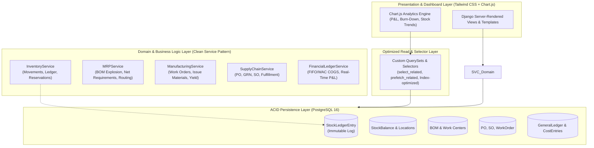

# Global-IMS: Manufacturing Resource Planning (MRP) & Inventory Management System
## Architectural Blueprint & System Memory Document

> **Document Status**: Living Architectural Specification  
> **Target Environment**: Production Enterprise  
> **Role / Perspective**: Senior Python Software Architect  
> **Project Scope**: End-to-end discrete manufacturing, multi-echelon inventory management, supply chain execution, and managerial accounting.

---

## 1. System Overview & Core Philosophy

Global-IMS is a high-performance, ACID-compliant Manufacturing Resource Planning (MRP II) and Inventory Management System designed to govern the full lifecycle of discrete production: from raw material procurement and multi-level Bill of Materials (BOM) management to shop-floor work orders, warehouse operations, order fulfillment, and real-time financial cost accounting (COGS & P&L).

### Guiding Architectural Principles
1. **Zero Data Ambiguity (Immutable Inventory Ledger)**: Inventory balances are never updated through arbitrary manual overwrites. All physical stock mutations are modeled as double-entry ledger records (`StockMovement`) encapsulated in strictly atomic database transactions.
2. **Deterministic Concurrency Control**: To eliminate race conditions, negative inventory, and double-allocation hazards during peak operations, all write operations employ row-level locking (`select_for_update`) within atomic transaction blocks.
3. **Strict Separation of Concerns (Service-Layer Architecture)**: Django models act as persistence and data integrity constraints; Django views act solely as transport controllers. All business rules, MRP netting calculations, and ledger allocations live in explicit, testable, and framework-agnostic **Service Layers**.
4. **Zero-N+1 Query Policy**: All read pathways must declare explicit prefetching (`select_related`, `prefetch_related`) via dedicated **Selector** modules.
5. **No Placeholders & No Deprecations**: All code artifacts produced throughout the project lifecycle must be complete, runnable, fully typed, documented, and conformant with Python 3.12+ and Django 5.x standards.

---

## 2. Technology Stack & Runtime Infrastructure

| Layer | Technology | Version / Specification | Rationale & Enterprise Role |
| :--- | :--- | :--- | :--- |
| **Language Runtime** | **Python** | `3.12+` | Strict static typing (`typing`), pattern matching, enhanced exception groups, high-performance runtime. |
| **Web Framework** | **Django** | `5.1+ LTS` | Enterprise-ready ORM, mature migration engine, robust security middleware (CSRF, XSS, Clickjacking prevention), and built-in RBAC. |
| **Database** | **PostgreSQL** | `16+` | Strict ACID guarantees, row-level locking (`FOR UPDATE`), partial/expression indexing, JSONB support for dynamic BOM specifications, and transactional DDL. |
| **Database Adapter**| **psycopg3** | `3.2+` | Modern asynchronous and pipeline-ready PostgreSQL driver with native connection pooling and typed Python adaptation. |
| **Styling & UI** | **Tailwind CSS** | `3.4+` | Utility-first, predictable design system configured for modern industrial enterprise dashboards with dark-mode support. |
| **Visual Analytics** | **Chart.js** | `4.4+` | High-fidelity canvas-based interactive charts for production burn-down, inventory turnover, stock distribution, and financial statements. |
| **Asynchronous Worker**| **Celery + Redis** | `Celery 5.4+, Redis 7+` | Long-running MRP recalculation runs, bulk ledger reconciliations, automated email dispatches, and periodic inventory snapshot tasks. |

---

## 3. High-Level System Architecture



---

## 4. Core Modules & Domain Blueprint

### 4.1. Inventory Management (Raw Materials & Finished Goods)
* **Item Classification**:
  * `RAW`: Raw materials procured from external suppliers.
  * `WIP`: Work-in-progress subassemblies manufactured in-house.
  * `FINISHED`: Final saleable goods.
  * `PACKAGING`: Packaging supplies.
  * `CONSUMABLE`: Shop-floor maintenance/operational items.
* **Multi-Warehouse & Storage Topology**:
  * Hierarchical locations: `Warehouse` -> `Zone` -> `Aisle` -> `Rack` -> `Bin`.
* **Lot & Batch Tracking**:
  * Expiration dates, manufacturer certificates of analysis (COA), quality quarantine flags (`PASSED`, `QUARANTINE`, `REJECTED`).
* **Unit of Measure (UoM) Engine**:
  * Base UoM (e.g., Kilogram, Meter, Each) with deterministic unit conversion ratios (e.g., 1 Box = 50 Each; 1 Drum = 200 Liters).
* **Double-Entry Stock Movement Ledger**:
  * Any stock change creates a signed `StockLedgerEntry`. Physical inventory balances at any given coordinate are an atomic projection of the ledger history.
  * Supported Movement Types:
    * `PURCHASE_RECEIPT` (Supplier -> Warehouse Bin)
    * `PRODUCTION_ISSUE` (Warehouse Bin -> Work Center WIP)
    * `PRODUCTION_OUTPUT` (Work Center WIP -> Warehouse FG Bin)
    * `SCRAP_DISPOSAL` (WIP/Stock -> Scrap Account)
    * `WAREHOUSE_TRANSFER` (Bin A -> Bin B)
    * `SALES_DISPATCH` (Warehouse FG Bin -> Customer)
    * `STOCK_ADJUSTMENT` (Cycle Count Variance Reconciliations)

### 4.2. Manufacturing (BOM & Work Orders)
* **Bill of Materials (BOM)**:
  * Multi-level hierarchical tree structure supporting subassemblies.
  * Versioning/Revisions (e.g., `REV-A`, `REV-B`) with effective start/end dates.
  * Per-component scrap allowance factor percentage (e.g., expected 2% machining loss).
  * Circular dependency detection using recursive CTE validation before commit.
* **Work Centers & Routing**:
  * Work Center capacity, standard hourly labor rate, machine cost rate, setup overhead.
  * Sequential operations (Step 10: Cutting, Step 20: Welding, Step 30: Powder Coating, Step 40: QA).
* **Material Requirements Planning (MRP Engine)**:
  * Gross-to-Net requirements calculation:
    $$\text{Net Requirement} = \max\left(0, \text{Gross Demand} - \text{On-Hand} - \text{Scheduled Receipts} + \text{Safety Stock}\right)$$
  * Backward scheduling based on supplier lead times and work center operation run times.
* **Work Order Execution Lifecycle**:
  * `DRAFT` $\rightarrow$ `CONFIRMED` $\rightarrow$ `RELEASED` (Materials Allocated) $\rightarrow$ `IN_PROGRESS` $\rightarrow$ `COMPLETED` $\rightarrow$ `CLOSED`.
  * Real-time variance tracking: Standard BOM cost vs. Actual material consumption & machine hours.

### 4.3. Sales & Purchases (Supply Chain Loop)
* **Procurement (Procure-to-Pay)**:
  * Requisition $\rightarrow$ Purchase Order (PO) $\rightarrow$ Goods Receipt Note (GRN) $\rightarrow$ Three-way Invoice Matching.
  * Incoming Quality Control (IQC) hold with partial acceptance and RMA (Return Material Authorization).
* **Sales & Fulfillment (Order-to-Cash)**:
  * Quotation $\rightarrow$ Sales Order (SO) $\rightarrow$ Real-time Inventory Soft-Reservation $\rightarrow$ Pick & Pack $\rightarrow$ Shipment Dispatch $\rightarrow$ Sales Invoice.
  * Credit limit verification and multi-tier pricing contracts.

### 4.4. Financial Dashboard & Cost Accounting
* **Costing Strategy**:
  * Support for **Moving Weighted Average Cost (WAC)** and **FIFO** valuation.
  * Cost breakdown per finished item: Direct Material + Direct Labor + Machine Overhead + Subcontracting.
* **Cost of Goods Sold (COGS) Engine**:
  * Instantaneous valuation upon `SALES_DISPATCH`:
    $$\text{COGS} = \sum_{\text{Dispatched Units}} \text{Unit Cost at Movement Time}$$
* **Executive Metrics & KPIs (Chart.js Visualization)**:
  * Real-Time P&L (Gross Revenue, Total COGS, Gross Margin, Operating Expenses).
  * Inventory Valuation by Category (Raw vs. WIP vs. FG).
  * Inventory Turnover Ratio:
    $$\text{Turnover} = \frac{\text{COGS}}{\text{Average Inventory Value}}$$
  * Manufacturing Scrap Cost Rate & Material Variance.
  * Stockout Risk Matrix & Days Inventory of Supply (DIS).

---

## 5. Database Strategy & Performance Guidelines

### 5.1. ACID Compliance & Concurrency Safeguards
1. **Atomic Transactions**:
   * Every business operation mutating stock, posting orders, or recording consumption must be wrapped in `transaction.atomic()`.
2. **Pessimistic Row-Level Locking**:
   * Before updating or reading an inventory balance for validation, invoke `.select_for_update(nowait=False)` on the `StockBalance` or parent record. This guarantees sequential consistency under concurrent stock reservations.
3. **Database-Level Integrity Constraints**:
   * Hard `CheckConstraint(condition=Q(quantity__gte=0))` on current stock balance records to guarantee negative inventory is physically impossible at the DB engine level.
   * `UniqueConstraint` on composite keys such as `[warehouse_id, item_id, batch_id]`.

```python
# Canonical Stock Reservation Pattern (Production-Standard)
from django.db import transaction
from apps.inventory.models import StockBalance
from apps.core.exceptions import InsufficientStockError

@transaction.atomic
def reserve_stock(item_id: int, warehouse_id: int, quantity_to_reserve: Decimal) -> StockBalance:
    """
    Safely reserves physical stock using row-level locking.
    Prevents race conditions and guarantees non-negative inventory balances.
    """
    stock_balance = (
        StockBalance.objects
        .select_for_update()
        .get(item_id=item_id, warehouse_id=warehouse_id)
    )
    
    if stock_balance.available_quantity < quantity_to_reserve:
        raise InsufficientStockError(
            f"Insufficient stock for Item {item_id} at Warehouse {warehouse_id}. "
            f"Available: {stock_balance.available_quantity}, Requested: {quantity_to_reserve}"
        )
    
    stock_balance.reserved_quantity += quantity_to_reserve
    stock_balance.save(update_fields=['reserved_quantity', 'updated_at'])
    return stock_balance
```

### 5.2. Query Optimization & Zero-N+1 Strategy
* **Explicit Relations**:
  * Use `select_related()` for all single-valued relationships (`ForeignKey`, `OneToOneField`).
  * Use `prefetch_related()` for multi-valued relationships (`ManyToManyField`, reverse `ForeignKey`).
* **Selector Pattern**: Views must never construct raw unoptimized queries. Query construction is encapsulated in `apps/<domain>/selectors.py`.
* **Database Indexing Blueprint**:
  * Composite B-Tree indexes on frequently joined / filtered columns:
    * `(item_id, warehouse_id)`
    * `(work_order_id, status)`
    * `(created_at, movement_type)`
  * Expression indexes for date-truncating financial reports: `DateTrunc('month', created_at)`.
* **Bulk Operations**:
  * Bulk creation of BOM components, multi-line order items, and stock movements must use `bulk_create(batch_size=500)` and `bulk_update(fields=[...], batch_size=500)`.

---

## 6. Coding Standards & Architectural Patterns

### 6.1. Modular Project Directory Structure
The repository strictly adheres to a domain-driven Django structure:

```
Global-IMS/
│
├── ARCHITECTURE.md                  # System Memory and Architectural Blueprint
├── manage.py
├── requirements/
│   ├── base.txt                     # Core dependencies (Django, psycopg3, etc.)
│   ├── local.txt                    # Development tooling (pytest, black, ruff)
│   └── production.txt               # Gunicorn, Sentry, Redis
│
├── config/                          # Project configuration root
│   ├── __init__.py
│   ├── asgi.py
│   ├── wsgi.py
│   ├── urls.py                      # Root URL dispatcher
│   └── settings/
│       ├── __init__.py
│       ├── base.py                  # Common configuration
│       ├── local.py                 # Development overrides
│       └── production.py            # Hardened enterprise settings
│
├── apps/                            # Domain Apps
│   ├── core/                        # Base models, custom mixins, global exceptions
│   │   ├── models.py                # TimeStampedModel, UUIDModel
│   │   ├── exceptions.py            # Global domain exceptions
│   │   └── utils.py
│   │
│   ├── inventory/                   # Items, Batches, Warehouses, Stock Ledger
│   │   ├── models.py
│   │   ├── services/                # InventoryService, ValuationService
│   │   ├── selectors/               # Stock queries, location balances
│   │   ├── views.py
│   │   ├── urls.py
│   │   └── forms.py
│   │
│   ├── manufacturing/               # BOM, Work Orders, Operations, MRP
│   │   ├── models.py
│   │   ├── services/                # BomExplosionService, MrpCalculationService
│   │   ├── selectors/
│   │   └── views.py
│   │
│   ├── purchasing/                  # Suppliers, POs, Goods Receipt Notes
│   │   ├── models.py
│   │   ├── services/
│   │   └── selectors.py
│   │
│   ├── sales/                       # Customers, Quotations, Sales Orders, Dispatch
│   │   ├── models.py
│   │   ├── services/
│   │   └── selectors.py
│   │
│   └── finance/                     # COGS Engine, P&L Reports, Valuation Analytics
│       ├── models.py
│       ├── services/                # CostAccountingService, ProfitLossService
│       ├── selectors/
│       └── views.py
│
├── static/
│   ├── css/                         # Compiled Tailwind CSS bundles
│   └── js/                          # Chart.js initializers & dashboard interactivity
│
└── templates/                       # Semantic HTML5 Templates (Tailwind-styled)
    ├── base.html                    # Master layout with responsive sidebar
    ├── components/                  # Navbar, Modals, Stat Cards, Data Tables
    ├── inventory/
    ├── manufacturing/
    ├── purchasing/
    ├── sales/
    └── finance/
```

### 6.2. Strict Coding Principles
1. **Type Annotations**: All function signatures must include full parameter and return type hints (`typing.Optional`, `typing.List`, `decimal.Decimal`, etc.).
2. **No Placeholders**: Never commit `pass`, `TODO`, or `...` stubs in production branches. Every function must have its complete operational implementation and error handling.
3. **Domain Exception Handling**: Custom domain errors subclass standard Python/Django exceptions (e.g., `BOMCycleDetectedError`, `WorkOrderAlreadyClosedError`) and are caught cleanly by view handlers to render informative user messages.
4. **Immutability of Audit Trails**: Financial and ledger models do not support `DELETE`. Voided transactions must be counter-balanced by an offsetting entry.

---

## 7. Security & Role-Based Access Control (RBAC)

### 7.1. Role Matrix
| Role | Inventory Module | Manufacturing (MRP) | Sales & Purchasing | Financial Dashboard |
| :--- | :--- | :--- | :--- | :--- |
| **Admin / Executive** | Full Access | Full Access | Full Access | Full Access |
| **Plant Manager** | Read / Transfer | Full Access | Read Only | View Production Costs |
| **Inventory Specialist**| Full Access (Issue/Receive)| Read Only | Receive / Dispatch | Read Stock Valuation |
| **Procurement Buyer** | Read Stock / Reorder | Read MRP Demand | Full PO Lifecycle | View Purchase Costs |
| **Sales Executive** | Read Stock Availability | Read Schedule | Full SO Lifecycle | View Pricing & Margins |
| **Cost Accountant** | Read All Ledgers | View BOM / Work Rates| View Invoices / POs | Full P&L / Cost Audit |

### 7.2. Hardening Standards
* **CSRF & Security Headers**: Strict CSRF protection on all mutating POST/PUT/DELETE requests; HSTS, X-Content-Type-Options, X-Frame-Options enabled in production.
* **SQL Injection Prevention**: Exclusive reliance on parameterized ORM queries; raw SQL queries are explicitly forbidden without senior architectural sign-off.
* **Audit Logging**: Every sensitive write operation logs the authenticated `User`, client IP, timestamp, and before/after delta.

---

## 8. Development Verification & Quality Gate Checklist

Before deploying any feature or code module:
- [ ] **Data Model Validations**: Are all positive quantities guarded by `CheckConstraint`?
- [ ] **Concurrency**: Are all ledger balance adjustments enclosed in `transaction.atomic()` with appropriate `select_for_update()` locking?
- [ ] **Performance Profile**: Does the query execution count remain $O(1)$ regardless of result set size (verified via Django Debug Toolbar / SQL logging)?
- [ ] **Code Coverage**: Does the service layer have automated unit test coverage for boundary conditions (e.g., zero quantity, negative inventory attempt, cyclical BOM, scrap calculation)?
- [ ] **Security**: Are view endpoints protected by appropriate permission decorators / mixins?
