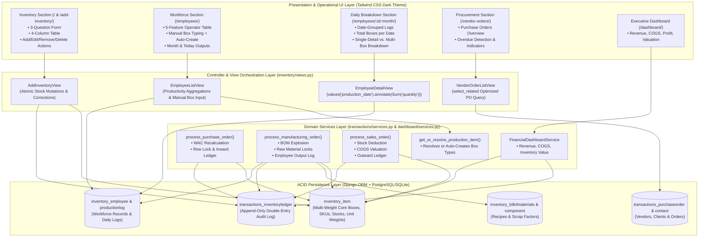

# Global-IMS: Manufacturing Resource Planning (MRP) & Inventory Management System
## Architectural Blueprint & System Memory Document

> **Document Status**: Living Architectural Specification (Synchronized with Codebase)  
> **Target Environment**: Production Enterprise & Discrete Manufacturing  
> **Role / Perspective**: Lead Software Architect  
> **Project Scope**: Discrete manufacturing, multi-weight core box inventory, workforce productivity tracking, immutable double-entry audit ledgers, procurement, and financial cost accounting.

---

## 1. System Overview & Core Philosophy

Global-IMS is a high-performance, ACID-compliant Manufacturing Resource Planning (MRP II) and Inventory Management System designed specifically for discreet industrial manufacturing and assembly plants. It governs the entire operational lifecycle: from raw material procurement and multi-level Bill of Materials (BOM) recipes to shop-floor workforce productivity, core box inventory management with multi-weight identity, and double-entry stock ledger auditing.

### Guiding Architectural Principles

1. **Zero Data Ambiguity & Multi-Weight Product Identity**:
   - Core box inventory distinguishes items not merely by name, but by the physical unit weight of an individual box.
   - Two boxes with the same name but differing unit weights (e.g., `GI Core Box` at `3.5 kg` vs. `5.2 kg`) are treated as strictly distinct inventory items with unique SKUs.
   - Weight strictly denotes the weight of **one single core box**, never an aggregate batch weight.

2. **Immutable Double-Entry Inventory Ledger**:
   - Inventory balances are never updated through unchecked manual overwrites.
   - All physical mutations (receipts, issues, deductions, corrections, and production outputs) are recorded in an append-only, immutable double-entry ledger (`InventoryLedger`) encapsulated in atomic database transactions.
   - Direct deletions and in-place updates of ledger entries are strictly blocked at both the Model and QuerySet levels.

3. **Deterministic Concurrency Control**:
   - To eliminate race conditions, negative inventory balances, and double-allocation hazards during peak operations, all write operations employ row-level locking (`select_for_update()`) within atomic transaction blocks (`transaction.atomic()`).
   - Hard database constraints (`CheckConstraint(current_stock >= 0)`) ensure data integrity at the database engine level.

4. **Shop-Floor Operational Ergonomics**:
   - High-throughput factory floor workflows require minimal cognitive friction.
   - The primary inventory entry form asks exactly **three direct questions**:
     1. *Name of the product*
     2. *Quantity*
     3. *Weight of the product (core box)*
   - The primary inventory presentation table presents a lean **4-column layout**:
     * `Name of Product` (with SKU)
     * `Quantity`
     * `Weight` (Unit weight of one core box in kg)
     * `Action` (`[Add]`, `[Edit]`, `[Remove]`, `[Delete]`)
   - Workforce tracking uses a streamlined **5-feature table**:
     * `Name of Employee`
     * `Boxes` (Direct manual text input with suggestions + instant save)
     * `Current Month Boxes`
     * `Daily Log`
     * `Delete`
   - Clutter such as redundant classification badges, separate inwards audit sub-tables, and non-actionable total weight calculations are removed in favor of clean, actionable metrics.

5. **Zero-N+1 Query Policy**:
   - All read pathways leverage explicit relational prefetching (`select_related`, `prefetch_related`) and database-level aggregations (`Count`, `Sum`, `Coalesce`).

---

## 2. Technology Stack & Runtime Infrastructure

| Layer | Technology | Version / Specification | Rationale & Enterprise Role |
| :--- | :--- | :--- | :--- |
| **Language Runtime** | **Python** | `3.12+` / `3.13` | Strict static typing hints (`typing`), pattern matching, enhanced exception handling, robust decimal precision. |
| **Web Framework** | **Django** | `5.1+ LTS` | Enterprise-grade ORM, mature migration engine, robust security middleware (CSRF, XSS, Clickjacking protection), and administrative interface. |
| **Database** | **SQLite (Dev) / PostgreSQL 16+ (Prod)** | Native / `psycopg3` | ACID guarantees, row-level locking (`FOR UPDATE`), check constraints, composite indexing, and transactional DDL configured via `django-environ`. |
| **Configuration** | **django-environ** | `0.11+` | 12-factor application architecture with environment variable extraction (`.env`). |
| **Localization & Timezone** | **Timezone Aware (IST)** | `default='Asia/Kolkata'` | Uses `timezone.localdate()` so day rollover automatically resets daily box counts at midnight locally. |
| **Static Assets** | **WhiteNoise** | `6.8+` | Self-contained, highly optimized production static file delivery without separate web server dependencies. |
| **Styling & UI** | **Tailwind CSS** | `3.4+ CDN` | Sleek dark-mode industrial theme (`bg-slate-900`/`bg-slate-950`), custom modals, responsive grid, and micro-animations. |
| **Typography** | **Google Fonts** | `Inter & JetBrains Mono` | Clean legibility for operational text and monospaced precision for numbers, SKUs, and weights. |
| **Visual Analytics** | **Chart.js** | `4.4+` | Executive dashboard visualizations for sales trends, revenue, and COGS performance. |

---

## 3. High-Level System Architecture



---

## 4. Repository Structure & Application Topology

The repository follows a clean, decoupled modular Django architecture:

```
Global-IMS/
│
├── ARCHITECTURE.md                  # Living System Architecture & Memory Document
├── manage.py                        # Django Management CLI
├── requirements.txt                 # Pinned Dependencies (Django, environ, whitenoise, etc.)
├── db.sqlite3                       # Local Development Database (ACID compliant)
├── .env.example                     # Environment Configuration Template
├── .env                             # Local Secrets (ignored by git)
│
├── core_erp/                        # Project Root & Configuration Module
│   ├── __init__.py
│   ├── settings.py                  # 12-Factor Settings, DB routing, Middleware
│   ├── urls.py                      # Root URL Dispatcher: / -> inventory, /admin/, /dashboard/
│   ├── wsgi.py                      # WSGI Entry Point
│   └── asgi.py                      # ASGI Entry Point
│
├── inventory/                       # Core Inventory, Workforce & Manufacturing Domain
│   ├── models.py                    # Item, BillOfMaterials, BOMComponent, Employee, ProductionLog
│   ├── views.py                     # AddInventoryView, EmployeeListView, EmployeeDetailView, VendorOrderListView
│   ├── urls.py                      # Primary Application Routes: /, /employees/, /vendor-orders/
│   ├── admin.py                     # Customized Admin with inline components and status badges
│   ├── apps.py                      # InventoryConfig
│   └── tests.py                     # 40+ Comprehensive Automated Unit & Integration Tests
│
├── transactions/                    # Immutable Ledger, Procurement & Commercial Transactions
│   ├── models.py                    # Contact (Vendor/Client), InventoryLedger, PurchaseOrder
│   ├── services.py                  # process_purchase_order, process_manufacturing_order, process_sales_order
│   ├── exceptions.py                # InsufficientStockError, BOMNotFoundError
│   ├── admin.py                     # Append-Only Ledger Admin with mutation locks
│   ├── apps.py                      # TransactionsConfig
│   └── tests.py                     # Transactional Concurrency and WAC Tests
│
├── dashboard/                       # Executive MRP Financial Analytics
│   ├── services.py                  # FinancialDashboardService (Revenue, COGS, Valuation)
│   ├── views.py                     # DashboardHomeView
│   ├── urls.py                      # /dashboard/ routes
│   ├── apps.py                      # DashboardConfig
│   └── tests.py                     # Financial Analytics Tests
│
├── static/                          # Global Static Assets
│   ├── css/
│   └── js/
├── staticfiles/                     # WhiteNoise Compiled Distribution Bundle
│
└── templates/                       # Semantic HTML5 Templates (Tailwind CSS Dark Theme)
    ├── base.html                    # Master Layout (Fixed Sidebar, Alerts, ACID Status)
    ├── add_inventory.html           # Root Template Alias -> inventory/add_inventory.html
    ├── employee_list.html           # Root Template Alias -> inventory/employee_list.html
    ├── employee_detail.html         # Root Template Alias -> inventory/employee_detail.html
    ├── vendor_orders.html           # Root Template Alias -> inventory/vendor_orders.html
    ├── inventory/
    │   ├── add_inventory.html       # 3-Question Form, 4-Column Table, Edit/Remove/Delete Modals
    │   ├── employee_list.html       # 5-Feature Workforce Table, Manual Box Typing + Datalist
    │   ├── employee_detail.html     # Date-Grouped Daily Breakdown, Single vs. Multi-Box Layout
    │   └── vendor_orders.html       # Procurement Purchase Orders Table & Overdue Alerts
    └── dashboard/
        └── home.html                # Executive Analytics Dashboard & Chart.js Visualizations
```

---

## 5. Core Domain Modules & Functional Specifications

### 5.1. Inventory Management Subsystem (`inventory/`)

#### Multi-Weight Core Box Identity
- Physical discrete core boxes are identified uniquely by both `name` and `weight`.
- Two items with the identical name but differing weights are stored as separate `Item` records with distinct alphanumeric SKUs (e.g. `CB-GI-CORE-BOX` vs. `CB-GI-CORE-BOX-01`).
- The `weight` field denotes the physical weight of **one single core box** in kilograms (kg), never an aggregate total.

#### Three-Field Acquisition Form
The form strictly collects:
1. **Name of the product**: Alphanumeric title (e.g., `GI Core Box 100mm`).
2. **Quantity**: Integer count of units to add or adjust.
3. **Weight of the product (core box)**: Decimal weight in kg (3 decimal places) representing one individual core box.

#### Lean Four-Column Table Layout
The inventory presentation table strictly contains:
1. **Name of Product**: Product title and unique system SKU.
2. **Quantity**: Current physical stock on hand.
3. **Weight**: Unit weight of one core box (`X.XXX kg / box`).
4. **Action**: Dedicated action triggers:
   - `[Add]`: Quick pre-fill to add additional stock for this specific core box.
   - `[Edit]`: In-place modal dialog to modify product name, quantity, or unit weight if entered incorrectly, automatically recording differential audit transactions.
   - `[Remove]`: Controlled deduction of units with positive balance validation and audit trail.
   - `[Delete]`: Complete removal of the product from the catalog, strictly enabled when current stock is zero (`current_stock == 0`).

#### Atomic Stock Mutation Operations
- **Stock Addition**: Increments `current_stock` and writes an `IN` ledger entry (`DIRECT-INWARD` or `NEW-PROD-INWARD`).
- **Product Editing**: Modifies `name`, `weight`, and `current_stock`. If quantity changes, creates an `EDIT-CORRECTION` ledger entry with the exact delta (`+` or `-`).
- **Stock Removal**: Asserts requested quantity $\le$ available stock. Decrements `current_stock` and writes an `OUT` ledger entry (`STOCK-REMOVAL`).
- **Product Deletion**: Allowed strictly if `current_stock == 0`. Attempts physical deletion; if protected by historical relational foreign keys (e.g., historical ledgers), performs safe deactivation (`is_active = False`).

---

### 5.2. Workforce Productivity & Daily Logs Subsystem (`inventory/`)

#### Streamlined Five-Feature Operator Table
The workforce dashboard (`/employees/`) presents strictly:
1. **Name of Employee**: Operator's full name (`first_name` + `last_name`).
2. **Boxes**:
   - Replaced `<select>` dropdown with a manual text input (`name="box_name"`) supported by a `<datalist>` of existing box types.
   - Direct numerical input for boxes manufactured today.
   - `[Save]` button with instant confirmation badge.
3. **Current Month Boxes**: Aggregated manufacturing output for the active calendar month.
4. **Daily Log**: Direct link to the employee's date-grouped daily log view.
5. **Delete**: Safe employee deletion / deactivation with modal confirmation.

#### Real-Time Catalog Auto-Resolution
When an operator types a new box name that does not exist in the catalog:
- `get_or_resolve_production_item` automatically creates a new `Item` record of type `Finished Good`.
- A deterministic, clean slug SKU (e.g., `FG-POLISH-BOX`) is generated.
- The box is immediately recorded in the employee's productivity log without manual catalog pre-configuration.

#### Multi-Tier Daily Breakdown Engine (`EmployeeDetailView`)
- Groups manufacturing outputs by `production_date` using database aggregation:
  ```python
  ProductionLog.objects.filter(employee=employee, production_date__month=month)
      .values('production_date')
      .annotate(Sum('quantity'))
  ```
- **Adaptive Daily Rendering**:
  - **Single Box Type**: If the employee manufactured only one type of box that day, displays the total with specific box details (e.g., `40 × GI Core Box (3.500 kg/box)`).
  - **Multiple Box Types**: If the employee manufactured different types of boxes on that day (e.g., `50 Core Box`, `10 Polish Box`, `10 Plastic Box`), displays the day's total (`70 Boxes`) alongside the full itemized breakdown of each box type, quantity, and unit weight.

---

### 5.3. Transactions & Immutable Double-Entry Ledger Subsystem (`transactions/`)

#### The Append-Only Ledger Law
All physical inventory mutations pass through `InventoryLedger`:
- **Model-Level Safeguards**: Calling `.save()` on an existing persisted record or `.delete()` raises a `ValidationError`.
- **QuerySet-Level Safeguards**: `InventoryLedgerQuerySet.update()` and `.delete()` raise `ValidationError` to prevent bulk mutations.
- **Transaction Types**:
  - `IN`: Procurement receipts, direct stock additions, and positive edit corrections.
  - `OUT`: Sales dispatches, shop-floor scrap, stock deductions, and negative edit corrections.
  - `MANUFACTURED`: Discrete assembly output from raw material conversion.

#### Procurement Workflow & Moving Weighted Average Cost (WAC)
Receipt of purchased goods executes within `@transaction.atomic` using pessimistic locking:
$$\text{WAC}_{\text{new}} = \frac{(\text{Stock}_{\text{old}} \times \text{Cost}_{\text{old}}) + (\text{Qty}_{\text{new}} \times \text{Price}_{\text{new}})}{\text{Stock}_{\text{old}} + \text{Qty}_{\text{new}}}$$

#### Purchase Orders Lifecycle
`PurchaseOrder` manages procurement fulfillment:
- Statuses: `Pending` and `Delivered`.
- Overdue Detection: Highlights in light red (`bg-red-950/40 border-l-4 border-red-500`) when `status == Pending` and `expected_delivery_date < today`.

---

### 5.4. Bill of Materials (BOM) & Manufacturing Execution

- Relational recipe through `BillOfMaterials` and `BOMComponent`.
- Components define `raw_material`, `quantity` per finished unit, and `scrap_percentage`.
- Production order execution (`process_manufacturing_order`):
  1. Resolves active BOM for the finished good.
  2. Calculates gross raw material requirements including scrap factor:
     $$\text{Gross Required} = \text{Component Qty} \times \text{Build Qty} \times \left(1 + \frac{\text{Scrap \%}}{100}\right)$$
  3. Acquires row-level locks on raw materials in sorted ID order to eliminate database deadlocks.
  4. Validates stock sufficiency; raises `InsufficientStockError` and rolls back atomically if short.
  5. Deducts raw material stock and logs `OUT` ledger entries.
  6. Increments finished good stock and logs `MANUFACTURED` ledger entry.
  7. Creates a `ProductionLog` for the assigned employee operator.

---

### 5.5. Executive Financial Dashboard (`dashboard/`)

Calculates key industrial accounting metrics for the current calendar period:
- **Gross Revenue**: $\sum (\text{Dispatched Units} \times \text{Selling Price})$
- **Cost of Goods Sold (COGS)**: $\sum (\text{Dispatched Units} \times \text{Moving Average Cost})$
- **Gross Profit**: $\text{Gross Revenue} - \text{COGS}$
- **Total Inventory Valuation**: $\sum (\text{Current Stock} \times \text{Moving Average Cost})$ across all active items.
- **Low Stock Alerts**: Real-time list of all items with current stock strictly below 10 units.

---

## 6. Concurrency Safeguards & Database Integrity Blueprint

### 6.1. ACID Concurrency Controls
1. **Atomic Transactions**: All mutations are wrapped in `transaction.atomic()` to ensure that partial failures roll back completely.
2. **Pessimistic Row-Level Locking**: High-concurrency operations use `select_for_update()` on `Item` rows before validating stock levels or modifying quantities.
3. **Database Check Constraints**:
   - `Item`: `CheckConstraint(current_stock >= 0)`
   - `Item`: `CheckConstraint(weight >= 0)`
   - `Item`: `CheckConstraint(moving_average_cost >= 0)`
   - `BOMComponent`: `CheckConstraint(quantity > 0)`
   - `ProductionLog`: `CheckConstraint(quantity > 0)`
   - `PurchaseOrder`: `CheckConstraint(quantity > 0)`

---

## 7. URL Routing & Navigation Architecture

| URL Route | View Handler | Template | Functional Purpose |
| :--- | :--- | :--- | :--- |
| `/` | `AddInventoryView` | `inventory/add_inventory.html` | **Primary Application Landing**: 3-question form, 4-column product table, stock mutations. |
| `/inventory/` | `AddInventoryView` | `inventory/add_inventory.html` | Canonical alias for inventory management. |
| `/add-inventory/` | `AddInventoryView` | `inventory/add_inventory.html` | Explicit route for inventory stock operations. |
| `/employees/` | `EmployeeListView` | `inventory/employee_list.html` | **Workforce Operations**: 5-feature operator table, manual box typing, today's output logging. |
| `/employees/<pk>/<month>/` | `EmployeeDetailView` | `inventory/employee_detail.html` | **Daily Productivity Breakdown**: Date-grouped breakdown showing single vs. multi-box type outputs. |
| `/vendor-orders/` | `VendorOrderListView` | `inventory/vendor_orders.html` | **Procurement**: Purchase orders overview with pending/overdue indicators. |
| `/dashboard/` | `DashboardHomeView` | `dashboard/home.html` | **Executive Analytics**: Top-line revenue, COGS, inventory valuation, and sales charts. |
| `/admin/` | Django Admin | Admin Default | Administrative data management with custom badges and audit locks. |

---

## 8. Quality Assurance & Verification Matrix

The system includes automated tests covering all critical operational pathways:

1. **Relational & BOM Integrity**: Validates forward/reverse BOM traversal, through-model constraints, and prevention of duplicate component additions.
2. **Multi-Weight Product Segregation**: Asserts that adding identical product names with different unit weights creates distinct `Item` records with separate SKUs.
3. **Stock Lifecycle & Edge Conditions**: Tests stock addition, in-place edit corrections, stock deductions, and deletion prevention when stock > 0.
4. **Workforce Productivity & Date Grouping**:
   - Tests `EmployeeListView` annotations (`total_boxes`, `today_boxes`).
   - Tests manual box typing with dynamic catalog resolution.
   - Tests daily breakdown for single box types vs. multi-box type days (e.g., 50 core box, 10 polish box, 10 plastic box).
5. **Transactional Integrity & Concurrency**:
   - Tests procurement receipts with accurate Moving Weighted Average Cost (WAC) recalculations.
   - Tests manufacturing order atomic rollbacks under stock shortages (verifying raw material balances remain intact).
   - Tests sales dispatch with accurate COGS and revenue computations.
6. **Immutable Ledger Preservations**: Asserts that update and delete attempts on `InventoryLedger` raise `ValidationError`.

---

## 9. Architectural Modification Log

| Release / Step | Core Architectural Change | Motivation & Business Driver |
| :--- | :--- | :--- |
| **v1.0** | Initial MRP & ERP Foundation | Established `core_erp`, `inventory`, `transactions`, and `dashboard` domain modules. |
| **v1.1** | Immutable Audit Ledger Engine | Enforced append-only double-entry ledger (`InventoryLedger`) with pessimistic row-locking (`select_for_update`). |
| **v1.2** | Simplified 3-Question Inventory Entry | Replaced complex inward entry forms with direct 3-question acquisition (Name, Quantity, Unit Weight). |
| **v1.3** | Multi-Weight Identity Law | Disconnected weight aggregation; established rule that different unit weights represent distinct products. |
| **v1.4** | Lean 4-Column Table & De-cluttering | Removed redundant classification badges and total weight calculations; established strict 4-column inventory table. |
| **v1.5** | Complete Lifecycle Actions (Edit / Remove / Delete) | Added in-place editing modal with differential ledger logging, stock removal modal, and zero-stock deletion safeguards. |
| **v1.6** | Streamlined 5-Feature Workforce Table | Reduced employee table to strictly 5 features: Name, Boxes, Current Month Boxes, Daily Log, and Delete. |
| **v1.7** | Manual Typing for Box Types | Removed `<select>` dropdowns; implemented manual text input with `<datalist>` and automatic catalog creation. |
| **v1.8** | Date-Grouped Multi-Box Daily Logs Engine | Grouped logs by date showing day's total boxes with adaptive single-type detail or multi-box type breakdown. |
| **v1.9** | Architectural Document & Codebase Synchronization | Fully audited codebase and aligned `ARCHITECTURE.md` with operational reality. |
